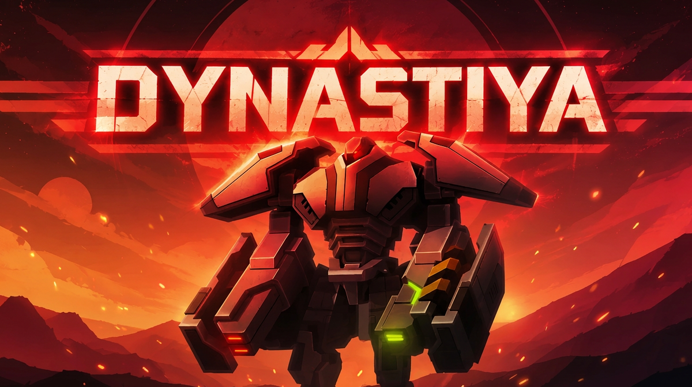

# Dynastiya

Dynastiya is a large-scale overhaul mod for Planetary Annihilation: TITANS. Its goal is to give players a cohesive, complete gameplay experience through a unified vision across server and client content.

Development is split across two repositories so server and client code and assets can be maintained separately:

- [pa.dynastiya.server](https://github.com/Planetary-Annihilation-Fandom/pa.dynastiya.server) contains the server-side part of the mod.
- [pa.dynastiya.client](https://github.com/Planetary-Annihilation-Fandom/pa.dynastiya.client) contains the client-side part of the mod.

Regenerate the optimized UI PNGs with `node tools/build-ui-resources.cjs [PA media directory]` (Node.js 22.2+); append `--check` to verify the checked-in files. The script removes Fireworks preview/layer chunks and losslessly compresses image data from installed PA originals, preserving pixels, colour information and attribution text; the game's asset licenses still apply.

Licenses and attribution: [licenses/README.md](licenses/README.md), with the original license texts and component-specific terms. Integration sources and changes are documented in [Integrations.md](Integrations.md).
